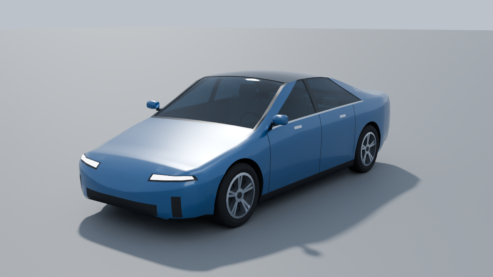

# CityCar: generic executive electric sedan for AI Empire

CityCar is a game-ready, low-poly model of a modern 4-door premium electric sedan (compact
executive class). It has no brand, no logo and no trademarked design element. The proportions come
from published data for the segment. It is split into separately named MeshParts, and each part's
pivot sits on its real axis, so game code can spin wheels, steer and seat a driver.



| File | What it is |
|---|---|
| `CityCar.fbx` | **The file to import into Roblox Studio.** 11 mesh objects, vertex colours and named materials. 1 unit = 1 stud. |
| `CityCar.obj` + `CityCar.mtl` | The same geometry for other tools (same frame and scale; materials as `Kd` colours, no vertex colours). |
| `manifest.json` | Objects, triangle counts, pivots (studs and m), hinge axes, rotation limits, bounding boxes, mesh checks, measured dimensions, anchors (seat, plates) and how the size relates to the game config. |
| `import_check.json` | Result of re-importing the FBX/OBJ into bpy, plus a raw parse of the FBX file without axis conversion. |
| `model.py` | The full, reproducible bpy 5.0.1 script: `python3 model.py` (or `--no-render`). |
| `render_front.png`, `render_side.png`, `render_top.png`, `render_34.png`, `render_34_rear.png` | Cycles renders of the views (CPU, 40 samples, OpenImageDenoise). |
| `render_closeup.png` | Close-up of the front wheel, headlight and arch. |
| `render_interior.png` | Cut-away with Body and Glass hidden: dashboard, screen, seats, steering wheel. |
| `render_roblox_preview.png` | What Studio should show: vertex colours × `MeshPart.Color`, with Body tinted in the game's fallback company colour (91,125,100). |
| `_research/` | BMW press technical data sheet (PDF + extracted text) used as reference B. |

---

## 1. Real-world proportions and sources

CityCar does not copy any one car. Each main dimension is the **mean of two published mid-size EV
sedans** (rounded to 5 mm), so it sits right in the segment:

| Dimension | Ref. A: 2024 Tesla Model 3 | Ref. B: BMW i4 eDrive40 | **CityCar (m)** | **CityCar (studs)** |
|---|---:|---:|---:|---:|
| Length | 4.720 | 4.783 | **4.750** | **16.964** |
| Width (body, without mirrors) | 1.850 | 1.852 | **1.850** | **6.607** |
| Width over mirrors | 2.088 (mirrors open) | 2.073 | **2.080** | **7.429** |
| Height | 1.441 | 1.448 | **1.445** | **5.160** |
| Wheelbase | 2.875 | 2.856 | **2.865** | **10.232** |
| Track front / rear | 1.584 / 1.584 | 1.601 / 1.630 | **1.593 / 1.607** | **5.689 / 5.739** |
| Ground clearance | 0.138-0.140 | 0.125 | **0.132** | **0.471** |
| Front / rear overhang | 0.841 / 0.978 (on the older 4.694 m body) | - | **0.860 / 1.025** | **3.071 / 3.661** |
| Tyre | 235/45 R18 | 225/55 R17 (std) | **235/45 R18, Ø 0.669 m** | **Ø 2.388** |

All CityCar values in this table were **measured on the finished mesh** (`manifest.json` ›
`dimensions_measured_from_mesh`), not just copied from the targets.

Sources:

* Ref. A, length, width, height, wheelbase and tyre for the 2024 model: CarsGuide
  <https://www.carsguide.com.au/tesla/model-3/car-dimensions/2024> and Cars.com
  <https://www.cars.com/research/tesla-model_3-2024/specs/>. Track and ground clearance for the 2024
  model (62.4 in = 1,584 mm; 5.4 in = 138 mm): <https://www.basenor.com/pages/model-3-highland-dimensions>
  and <https://www.basenor.com/pages/model-3-highland-vs-legacy-comparison>.
* Ref. A, overhangs (841 / 978 mm), width with mirrors open (2,088 mm) and ground clearance
  (140 mm) for the earlier body: Tesla Model 3 Owner's Manual, "Dimensions",
  <https://www.tesla.com/ownersmanual/2017_2023_model3/en_th/GUID-56562137-FC31-4110-A13C-9A9FC6657BF0.html>.
  This page returned HTTP 403 to my fetcher, so I took these values from the search-engine extract of
  that page. They also match the length sum: 841 + 2,875 + 978 = 4,694 mm.
* Ref. B: BMW Group press kit "Technical specifications. BMW i4", 06/2021 (length/width/height
  4783/1852/1448, wheelbase 2856, track 1601/1630, ground clearance 125, tyres 225/55 R17),
  <https://www.press.bmwgroup.com/mexico/article/attachment/T0334074ES/480974> (copy in `_research/`).
  The 2,073 mm width with mirrors is from EV Database <https://ev-database.org/car/1252/BMW-i4-eDrive40>.
* The front/rear overhang split is the one place I chose a value myself: 0.860 m at the front (ref. A:
  0.841 m on a 26 mm shorter body), with the rest (1.025 m) at the rear so the length adds up.
* The cabin layout comes from the same class and is approximate: windshield base 1.05 m ahead of the
  wheelbase centre, roof peak 1.445 m, driver cushion top 0.505 m above the ground, steering wheel
  Ø 0.37 m with the column 24° above horizontal.

The brand names appear **only here, as cited sources**. Nothing in the model, its object names,
materials or file names refers to a brand.

## 2. Roblox scale and limits (verified in the official docs)

| Rule | Value | Source |
|---|---|---|
| Real-world scale | **1 stud = 28 cm**, so 1 m = 3.5714 studs. The docs recommend standard Roblox units. | <https://create.roblox.com/docs/physics/units> |
| Triangle limit | "Individual meshes can not exceed **20,000 triangles**." Meshes must also be watertight, have no 0-thickness geometry, and use quads where possible. | <https://create.roblox.com/docs/art/modeling/specifications> |
| Transforms | Frozen transforms: scale 1,1,1 and rotation 0,0,0. | same page |
| Importer | **File ▸ Import** opens the 3D Importer (`.fbx`, `.gltf`, `.obj`). FBX/glTF support multiple mesh objects, hierarchies and vertex colours. Options include Import Only As Model, Upload to Roblox, Add to Workspace, Set Pivot to Scene Origin, Anchored, World Forward/Up, Scale Unit (default Studs), Merge Meshes, Use Imported Pivot and Ignore Vertex Colors. | <https://create.roblox.com/docs/studio/importer> |
| Blender FBX export | Path Mode Copy + Embed Textures; Apply Scalings = **FBX Unit Scale**; no leaf bones; no baked animation. | <https://create.roblox.com/docs/art/modeling/export-requirements> |
| Blender axes / scale | Scene Unit System = None. Export **Forward = Z Forward, Up = Y Up**. "FBX Unit Scale" keeps "the same scale in Studio" (other scale values stay at 1.0). | <https://create.roblox.com/docs/art/blender> |
| Textures | Up to 4096×4096. CityCar uses no textures. | <https://create.roblox.com/docs/art/modeling/texture-specifications> |
| Vertex colour × part colour | Vertex colours are "multiplied against the BrickColor or Color property of the meshPart". Use white (255,255,255) to see them exactly. | Roblox staff tutorial <https://devforum.roblox.com/t/vertex-colored-meshes-using-blender-and-studio/3050119> |

**How CityCar meets them**

* **Scale factor:** the model is built in metres, and every mesh is then multiplied by **1/0.28 = 3.571429**.
  So **1 Blender unit = 1 stud** (scene Unit System None, Unit Scale 1.0).
* **Triangles:** the biggest mesh is Body with **7,836** triangles (39 % of the 20,000 limit). The
  total is **14,184**, under the ≤ 15k target for the car.
* **Quads vs triangles:** the docs ask for quads "where possible" while modelling. The exported FBX is
  triangulated on purpose, so the triangle count Studio sees is exactly the one in the manifest.
* **Geometry:** every mesh is closed (**0 non-manifold edges**), has a positive signed volume (normals
  point outward) and has no n-gons. Body is a 25 mm thick shell, so it has real volume and window
  reveals. Every object has rotation 0 and scale 1.
* **Shading:** smooth, with angle-based sharp edges (Body 38°, others 30-40°). Normals are written into
  the FBX.

## 3. Frame, export settings, scale

* **Model frame (Roblox, studs): front = −Z** (the Model's LookVector, the same as VehicleService's
  `CFrame.lookAt`/`LookVector` driving), **right = +X, up = +Y**. The origin is on the **ground**, on
  the centre line, **half-way between the axles**. The driver sits on the **left (−X)**, like the
  procedural car's `DriverSeat` at x = −1.35.
* Blender frame (inside `model.py`): +X = car left, +Y = rear, +Z = up. FBX export with
  `axis_forward='Z', axis_up='Y'` maps Blender (x, y, z) to file (−x, z, y), which is the Roblox frame
  above.
* **FBX** (`bpy.ops.export_scene.fbx`): `apply_scale_options='FBX_SCALE_UNITS'`, `global_scale=1.0`,
  `apply_unit_scale=True`, `axis_forward='Z'`, `axis_up='Y'`, `bake_space_transform=True`,
  `object_types={'MESH'}`, `mesh_smooth_type='FACE'`, `colors_type='SRGB'`, `use_triangles=True`,
  `add_leaf_bones=False`, `bake_anim=False`, `path_mode='COPY'`, `embed_textures=True` (no textures
  are used, so nothing gets embedded).
* **OBJ** (`bpy.ops.wm.obj_export`): `forward_axis='Z'`, `up_axis='Y'`, scale 1, normals + UVs +
  materials (`.mtl`), triangulated.
* The FBX header written by Blender says UpAxis = Y, FrontAxis = Z (sign −1), UnitScaleFactor = 100.
  The node translations in the file equal `pivot_studs` from the manifest (checked, see §6).

## 4. Objects, pivots and motion

Pivots are in **model space, in studs**, relative to the model origin. Rotations use the right-hand
rule. `manifest.json` holds the same data with bounding boxes and per-object notes.

| Object | Kind | Tris | Pivot (studs) | Axis | Limits | CanCollide |
|---|---|---:|---|---|---|---|
| Body | static (root) | 7836 | 0, 0, 0 | - | - | **true** |
| Glass | static | 792 | 0, 0, 0 | - | - | false |
| Headlights | static | 176 | 0, 0, 0 | - | - | false |
| Taillights | static | 328 | 0, 0, 0 | - | - | false |
| Wheel_FL | wheel | 908 | −2.845, 1.194, −5.116 | spin +X; steer +Y | steer ±30° | false |
| Wheel_FR | wheel | 908 | 2.845, 1.194, −5.116 | spin +X; steer +Y | steer ±30° | false |
| Wheel_RL | wheel | 908 | −2.870, 1.194, 5.116 | spin +X | - | false |
| Wheel_RR | wheel | 908 | 2.870, 1.194, 5.116 | spin +X | - | false |
| Interior | static | 856 | 0, 0, 0 | - | - | false |
| Seat_Driver | seat anchor | 232 | −1.339, 1.804, −0.571 | - | - | false |
| SteeringWheel | rotating | 332 | −1.339, 3.071, −1.786 | (0, 0.4067, 0.9135) | ±450° (game: ±120°) | false |
| **Total** | | **14184** | | | | |

* **Wheels:** the pivot is the wheel centre, and the axle runs along local X. Radius = 1.194 studs
  (0.334 m). Moving forward (towards −Z) is a **negative** angle about +X:
  `pivot * CFrame.Angles(-distance / 1.194, 0, 0)`. Steering: a **positive** angle about +Y turns the
  wheel's front to the car's left (−X). The well's inner wall leaves room for about ±30°.
* **SteeringWheel:** the pivot is the hub centre. The axis is the column, pointing from the dashboard
  towards the driver (up 24°). A positive angle turns the rim counter-clockwise as the driver sees it,
  which is steering left.
* **Seat_Driver:** this is the visible driver seat. Its pivot is the **top centre of the cushion**,
  0.505 m (1.80 studs) above the ground. Put a VehicleSeat (Size 2, 0.5, 2) there:
  `seat.CFrame = model.Seat_Driver:GetPivot() * CFrame.new(0, -0.25, 0)`. Headroom from the cushion to
  the inside of the roof is about 0.91 m (3.25 studs).
* **Static parts** (Glass, Headlights, Taillights, Interior) are welded to Body. Their pivots are the
  model origin.
* **Other anchors** (manifest `anchors`, in studs): front plate face centre (0, 1.125, −8.128) facing −Z,
  rear plate recess centre (0, 2.000, 8.725) facing +Z, passenger seat top (1.339, 1.804, −0.571).

## 5. Materials and colours

Roblox gives one material and colour per MeshPart. So every face also stores **its material colour
as an FBX vertex colour**, and Studio multiplies that by `MeshPart.Color`.

* **Body paint is baked white.** So `Body.Color` = the paint colour: the game can tint every car
  in the company colour. Trim, roof, wheel wells and cladding are dark and stay dark under any tint.
  The chrome strips and handles take on a little of the tint. `render_roblox_preview.png` shows the
  tint working.
* Set every **other** part's `Color` to **white (255,255,255)** so its vertex colours show exactly.
* Glass: vertex colour #1E2A33. Use `Transparency` 0.35 and `Material` Glass so the interior shows
  through.
* Headlights #F3F6FF, Taillights #D8101F. Set `Material = Neon` when the lights are on (taillights:
  brake light).

| Material (FBX name) | sRGB (render) | Vertex colour | Used on |
|---|---|---|---|
| Paint | #2B5A86 | **#FFFFFF** (tint via Body.Color) | body panels, mirror caps |
| Trim_Black | #121417 | same | pillars, frit, window reveals, headlight housings, plate recess |
| Roof_Black | #0A0D11 | same | panoramic roof |
| Cladding | #1D1F22 | same | side skirts, lower intake, corner vents, diffuser |
| Chrome | #C9CDD3 | same | belt-line strip, door handles |
| Panel_Gap | #0C0D0F | same | door shut lines |
| Wheelwell / Underbody / Body_Inner | #17181A / #1A1B1D / #2A2C30 | same | wheel wells, floor, inside of the shell |
| Headlight / Taillight | #F3F6FF / #D8101F | same | light strips (on Body under the light meshes as well) |
| Mirror_Glass | #A9B3BD | same | mirror faces |
| Glass | #6E8696 | **#1E2A33** | all glazing |
| Tire / Rim_Silver / Wheel_Dark / Hub_Dark | #1C1C1E / #BCC1C8 / #2A2D31 / #3A3D42 | same | wheels |
| Interior_Dark / Seat_Leather / Interior_Trim / Screen | #2B2D31 / #D9D3C6 / #9EA3AA / #0E1A26 | same | cabin |

No textures, so nothing needs to be shipped next to the FBX.

## 6. Verification

Done by `model.py` itself. Results are in `import_check.json`.

1. **FBX re-import into bpy:** 11 objects, **14,184 triangles** (identical per object). Overall
   bounding box **7.429 × 5.160 × 16.964 studs** (width over mirrors × height × length) =
   2.080 × 1.445 × 4.750 m. Lowest point Y = 0 (tyres on the ground), body underside at 0.471 studs.
   Every pivot matches the manifest to 0.01 stud, every object has scale 1, and vertex colours are
   present. **0 mismatches.**
2. **Raw FBX parse** (the file read without axis conversion, as a Y-up importer sees it): every node
   has Lcl Rotation 0,0,0 and Lcl Scaling 1. Node translations equal `pivot_studs`. The nose is at
   Z = −8.19, the tail at Z = +8.78, the driver side at −X.
3. **OBJ re-import:** 11 objects, 14,184 triangles, same 7.429 × 5.160 × 16.964 studs.
4. **Mesh checks per object** (`manifest.json` › `mesh_check`): 0 non-manifold edges, positive volume,
   0 n-gons, all well under 20,000 triangles.
5. **Renders inspected** from every view, plus a close-up of the headlight and the wheel, the cut-away
   interior and the vertex-colour preview. During the work this caught and fixed a headlight strip
   with a notch, a jagged taillight end, a wheel-well colour leak onto the fender and a skirt that was
   too tall. The final renders show no gaps between parts and no z-fighting.

## 7. Importing into Roblox Studio

1. **File ▸ Import** and choose `CityCar.fbx`. Use the FBX: only FBX/glTF carry several meshes and
   vertex colours.
2. In the Import Preview:
   * **File General:** Name = `CityCar`. **Import Only As Model = on** (the default, which gives one
     `Model` with 11 MeshParts). Upload to Roblox = on if you want an asset id. **Set Pivot to Scene
     Origin = on** (the Model pivot then lands on the ground between the axles). **Anchored = off.**
   * **File Transform:** World Forward = **Front**, World Up = **Top** (the defaults).
   * **File Geometry:** **Scale Unit = Studs**. **Merge Meshes = off** so every part stays a separate
     MeshPart.
   * **Object General** (per child): **Use Imported Pivot = on** (the default). `part:GetPivot()` then
     returns the hinge/axle/seat point. Note that `part.CFrame` is still the bounding-box centre;
     for wheels that is the same point, for SteeringWheel and Seat_Driver it is not.
   * **Object Geometry:** Ignore Vertex Colors = **off**.
3. **Check after import** (Command Bar):
   * `print(workspace.CityCar:GetExtentsSize())` should print about `7.43, 5.16, 16.96`. If it is
     about 3.57 times bigger or smaller, the Scale Unit was not Studs: re-import with Studs, or use
     `Model:ScaleTo()`.
   * **The nose must point to −Z:** `print(workspace.CityCar.Headlights.Position.Z < workspace.CityCar.Taillights.Position.Z)`
     should print `true`. If it prints `false`, your Studio version flips the file's forward axis:
     re-import with World Forward = **Back**.
   * Driver on the left: `print(workspace.CityCar.Seat_Driver:GetPivot().X < 0)` should print `true`.
4. **Where the game expects it:** in the Explorer, create the `Folder` `ReplicatedStorage ▸ VehicleAssets`
   if it does not exist yet. Move the imported Model into it and name it exactly **`CityCar`**:
   `ReplicatedStorage ▸ VehicleAssets ▸ CityCar`. Its direct children are the MeshParts `Body`,
   `Glass`, `Headlights`, `Taillights`, `Wheel_FL`, `Wheel_FR`, `Wheel_RL`, `Wheel_RR`, `Interior`,
   `Seat_Driver`, `SteeringWheel`. Set **`CityCar.PrimaryPart = Body`**.
5. **Properties:**

   | Part(s) | Anchored | CanCollide | CanQuery / CanTouch | Massless | Other |
   |---|---|---|---|---|---|
   | Body | false | **true** (CollisionFidelity Hull or Box) | true | false | Color = paint/company colour |
   | Glass | false | false | false | true | Color white, Transparency 0.35, Material Glass |
   | Headlights, Taillights | false | false | false | true | Color white; Material Neon when on |
   | Wheel_FL/FR/RL/RR | false | false | false | true | Color white |
   | Interior, Seat_Driver, SteeringWheel | false | false | false | true | Color white |

   For the car to touch the ground, use the game's own invisible chassis/raycast as VehicleService
   already does, or invisible collision parts. The visual wheels do not collide.
6. **Wiring.** This is a suggestion: the snippet was **not run in Studio**, but it only uses standard
   API (`WeldConstraint`, `Motor6D.Transform`, `GetPivot`, `PivotOffset`):

   ```lua
   local car = ReplicatedStorage.VehicleAssets.CityCar:Clone()
   local body = car.Body
   for _, p in car:GetChildren() do
       if p:IsA("MeshPart") and p ~= body then
           p.Color = Color3.new(1, 1, 1); p.Anchored = false; p.CanCollide = false; p.Massless = true
           if p.Name:match("^Wheel_") or p.Name == "SteeringWheel" then
               local m = Instance.new("Motor6D")            -- rotates about the imported pivot
               m.Part0 = body; m.Part1 = p
               m.C0 = body.CFrame:ToObjectSpace(p:GetPivot())
               m.C1 = p.PivotOffset
               m.Name = p.Name .. "_Motor"; m.Parent = p
           else
               local w = Instance.new("WeldConstraint"); w.Part0 = body; w.Part1 = p; w.Parent = p
           end
       end
   end
   body.Color = companyColor
   car.Glass.Transparency = 0.35; car.Glass.Material = Enum.Material.Glass
   local seat = Instance.new("VehicleSeat")
   seat.Size = Vector3.new(2, 0.5, 2); seat.Transparency = 1; seat.CanCollide = false; seat.Massless = true
   seat.CFrame = car.Seat_Driver:GetPivot() * CFrame.new(0, -0.25, 0); seat.Parent = car
   local sw = Instance.new("WeldConstraint"); sw.Part0 = body; sw.Part1 = seat; sw.Parent = seat
   -- per frame: front wheel motor.Transform = CFrame.Angles(0, steer, 0) * CFrame.Angles(-spin, 0, 0)
   --            rear wheel motor.Transform  = CFrame.Angles(-spin, 0, 0)      (spin = distance / 1.194)
   --            steering motor.Transform    = CFrame.fromAxisAngle(Vector3.new(0, 0.4067, 0.9135), steerAngle)
   ```

   The steering axis is given in model space. The imported pivots carry no rotation, so the motor frame
   has the same orientation as the model and the axis can be used as it is.

## 8. How the size relates to the game's existing cars

I read `CampusConfig.CARS` and `VehicleService` but did not change them.

* `CampusConfig.CARS` "executive" ("Executive Electric") is **15 × 7 studs** (length × width).
  CityCar at real scale is **16.96 studs long, 6.61 studs wide over the body, and 7.43 studs over the
  mirrors**. That is 13 % longer and 6 % narrower over the body than the procedural box car, and
  slightly wider over the mirrors. The procedural car also puts its wheels outside the body
  (x = ±(width/2 + 0.12)), which makes it look wider. To match the config length exactly, use
  `car:ScaleTo(0.8842)` (`manifest.json` › `game_config_relation`). I recommend keeping real scale.
* VehicleService puts the chassis centre 2.2 studs above the ground (wheel centre −0.8, wheel Ø 2.8 studs).
  Its `DriverSeat` sits at (−1.35, 1.5, 0.2) from the chassis, so the seat top is about 3.95 studs
  above the ground. CityCar's real wheel is Ø 2.39 studs, and the driver cushion top is 1.80 studs above
  the ground at x = −1.34. **The side matches; the height is much more realistic.** If the game keeps
  its physics chassis, place the visual model with `car:PivotTo(chassis.CFrame * CFrame.new(0, -2.2, 0))`
  and the VehicleSeat at `Seat_Driver:GetPivot()`.
* Driving direction is the same: the game drives along the chassis LookVector (−Z), and the CityCar
  nose is at −Z.
* VehicleService does not read `ReplicatedStorage.VehicleAssets` yet. It still builds the car from
  Parts. Using this asset needs a code change on the game side (see "Open issues").

## 9. What is simplified (honest list)

* **One generic body** from parametric cross-sections: a smooth "bar of soap" EV shape with a crisp
  belt line, a fastback roofline and rounded nose and tail. There are no fine surface creases,
  shut lines on the hood or trunk, wipers, washer jets, sensors, antenna, charge port, badges or
  number plates (plate anchors are in the manifest).
* **Doors, hood and trunk do not open.** Door shut lines, flush handles and the chrome belt strip are
  colour zones on Body.
* **Windows** are fixed. The side windows have no visible frames, and the windshield/backlight have
  a black frit border. The roof is an opaque "black glass" zone on Body, not real glass.
* **Lights** are thin raised strips (4 mm proud) with no lens detail. Indicators and reversing lights
  are not separate. The light-zone faces on Body under the strips have the same colour, so you never
  see z-fighting.
* **Wheels:** tyre without tread or lettering. Five twin-spoke rim, dark wheel face, hub and cap.
  There are no brake discs or calipers. Wheels steer about a vertical axis through the wheel centre,
  not a real kingpin axis. There is no suspension travel; the wells give about 5 cm of tyre-to-arch
  gap.
* **Interior:** simple chamfered boxes. The dashboard is one loft with a trim strip and a centre
  screen. There is a console, a passenger seat, a rear bench with three headrests, a parcel shelf and
  armrests. There are no pedals, door cards or seatbelts. The inside of the 25 mm body shell serves as
  door panels and headliner.
* **Mirrors** are part of Body (they do not fold).
* **Vertex-colour tint:** `Body.Color` multiplies all Body vertex colours, so the chrome strips and
  mirror glass also pick up a little of the company colour.

## 10. Open issues

* **Studio itself could not be run here.** The import settings follow the official docs. The FBX was
  checked by re-import into Blender and by a raw parse of the file. The size, nose-direction and
  driver-side checks in §7.3 are there in case your Studio version treats the forward axis or unit
  differently.
* **Game integration is not done.** VehicleService still builds the "executive" car from Parts and
  does not clone `ReplicatedStorage.VehicleAssets.CityCar`. The seat, wheel and size data needed for
  that is in `manifest.json`.
* Collision: only Body collides, and a hollow shell is a poor collider. Use CollisionFidelity Hull or
  Box, or keep the game's own chassis part for physics.
* The Roblox character's sitting height against the 0.91 m headroom has not been tested in Studio.
  A tall avatar's head may touch the black glass roof.
