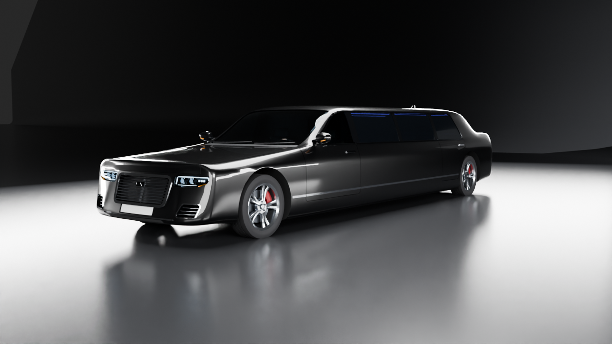

# ExecutiveLimo: VIP stretch limousine for AI Empire

ExecutiveLimo is the company chauffeur car. It picks the founder up at the HQ, drives to the airport, and waits at
the Port Meridian VIP stand. It is a modern stretch limousine without a brand: midnight metallic paint, chrome
accents, privacy glass, and a full lounge inside with a long leather side bench, a rear bench, a refreshment bar,
a TV partition, a star-light ceiling and ambient LEDs.

The model has 29 named MeshParts and **69,910 triangles**. The size is real-world, at the same scale as CityCar
(1 stud = 0.28 m). Every part's pivot is on its real axis (wheel axles, door hinges, steering column). Seat, door
and light anchors are in the manifest.

| File | What it is |
|---|---|
| `ExecutiveLimo.fbx` | **The file to import into Roblox Studio.** 29 mesh objects with vertex colours and named materials. 1 unit = 1 stud. |
| `ExecutiveLimo.obj` + `.mtl` | The same geometry for other tools (same frame and scale; materials as `Kd` colours, no vertex colours). |
| `manifest.json` | For each object: triangle count, pivot (studs and m), hinge or spin axes, open angles, bounding box, mesh checks and suggested MeshPart properties. Also: anchors (seats as CFrames with R6 rig roots, door entry points, light and plate points), measured dimensions, the game numbers it was fitted to (`game_fit`), and `game_scale` (recommended scale plus every pivot and anchor at that scale). |
| `import_check.json` | The FBX and OBJ re-imported into bpy, plus a raw parse of the FBX file without axis conversion. |
| `model.py` | The complete, reproducible bpy 5.0.1 script: `python3 model.py` (or `--no-render`, `--preview`, `--only=render_x.png`). |
| `render_hero.png`, `render_rear34.png`, `render_side.png`, `render_top.png` | Studio renders (Cycles CPU, 56 samples with OpenImageDenoise, 1280×720). |
| `render_interior.png` | The lounge seen through the open rear-right door: bar, side bench, star ceiling, LEDs, partition with window and TV. |
| `render_closeup_front.png`, `render_closeup_wheel.png` | Close-ups of the headlight and grille, and of a front wheel (rim, disc, caliper). |
| `render_doors_open.png`, `render_interior_cutaway.png`, `render_roblox_preview.png` | Extras: driver and rear-left doors open; a top cut-away of the whole cabin; what Studio should show (vertex colours × the manifest's MeshPart colours). |
| `_research/` | The licensing PDF (with extracted text) and `sources.md` with the quotes used. |
| `_dev/` | Development leftovers (preview renders, logs, earlier states). `_dev/check_fit.py` is the fit / collision checker used in fix round 2 (door sweeps, entry boxes, wheel wells, stars; results for the delivered FBX in `_dev/fix/check6.json`), `_dev/fix/precise.py` the double-precision star / small-triangle check. Not needed for the game. |

---

## 1. Real stretch-limo proportions and sources

ExecutiveLimo is a generic full-size executive sedan, 5.30 m long with a 3.05 m wheelbase, **stretched by 90 in
(2.286 m)** in the middle. The stretch is longer than the 70 in coachbuilt limousine (reference A) and shorter than
the 120 in maximum (references B and C). This keeps the car as "crazy" as a real stretch limousine while it stays
drivable in the game's streets.

| | Ref. A: coachbuilt 70 in limo (XTS base) | Ref. B: Town Car base / limo chassis | **ExecutiveLimo (measured from the mesh)** |
|---|---:|---:|---:|
| Base sedan length / wheelbase | 202.0 in (5.131 m) / 111.7 in (2.837 m) | 215.4 in (5.471 m) / 117.7 in (2.990 m) | 5.30 m / 3.05 m (generic donor) |
| Stretch | 70 in (1.778 m) | max. 120 in (3.048 m) | **90 in (2.286 m)** |
| Limo length | 272.0 in (6.909 m) | 8.52 m at 120 in (computed) | **7.591 m = 27.11 studs** |
| Limo wheelbase | 171.7 in (4.361 m) | 6.04 m at 120 in (computed) | **5.336 m = 19.06 studs** |
| Body width | – | 78.5 in (1.994 m) | **1.958 m = 6.99 studs** (2.150 m = 7.68 studs over the mirrors) |
| Height | – | 59.0 in (1.499 m) | **1.500 m roof = 5.36 studs** (1.559 m = 5.57 studs including the antenna fin) |
| Rear door opening | 40 in (limo) vs 33 in (base) | – | rear door 0.94 m long at the belt |
| Front / rear overhang | – | – | 0.998 m / 1.257 m (3.56 / 4.49 studs) |
| Track, tyre | – | – | 1.66 m (5.93 studs), 245/45 R19 (Ø 0.703 m = 2.51 studs) |
| Ground clearance | – | – | 0.14 m (0.50 studs) between the axles |
| Side windows | conventional stretch limo (D): separate side windows next to each other in the stretch section, with wall posts between the windows and between windows and doors | sedan base: one window in each of the 2 doors per side (B) | **4 per side**: front door, two stretch windows, rear door. Gloss-black B, centre and C posts between them, one chrome surround around all of them |
| Passengers | max. 8 (licensing rule C) | | 6 in the lounge (3 rear bench + 3 side bench) + front passenger seat |
| Seat width | ≥ 400 mm per seat (C) | | rear bench 0.40 m per seat, side bench 0.69 m per seat |
| Stretch as licensing measures it | ≤ 3,048 mm, from the front door's rear edge to the rear door's front edge (C) | | 2.36 m |

Sources (all opened; quotes in `_research/sources.md`; reference A re-checked on 2026-10-11):
* **A:** Lehmann-Peterson "XTS Limo" spec table: <https://lehmann-peterson.com/vehicles/limo>. Wheelbase 111.7 →
  171.7 in, overall length 202.0 → 272.0 in, rear door opening 33 → 40 in, "Maximum stretch length of 70"".
* **B:** Lincoln Town Car 1998-2011 dimensions: <https://en.wikipedia.org/wiki/Lincoln_Town_Car>. The MKT limousine
  chassis can be "stretched by up to 120 inches":
  <https://www.autoguide.com/auto-news/2011/02/lincoln-mkt-town-car-set-to-take-up-the-livery-car-mantle-from-the-panther-platform.html>.
* **C:** Carmarthenshire County Council, conditions for stretched limousines. It allows up to 8 passengers, needs at
  least 400 mm per seat, allows side-facing seats and darkened rear glass, and limits the stretch to 120 in:
  <https://www.carmarthenshire.gov.wales/media/ssvayzte/conditions-applied-to-stretch-limousines.pdf> (copy in `_research/`).
* Layout (seating along the sides, partition with an openable glass section): <https://en.wikipedia.org/wiki/Limousine>.
* **D:** side-window layout of a conventional stretch limousine: Krystal Koach patent US6116678 A ("Limousine side
  structure and window sealing method", filed 1998, background section): "windows 12 in the side wall 14 of the
  limousine are positioned next to each other with a portion 14a of the side wall extending up to the roof", with
  side-wall portions "between the windows 12 and between the windows and doors 20":
  <https://patents.google.com/patent/US6116678>. The 4-window layout = the base sedan's two door windows (B) plus two
  stretch windows separated by a centre post. (Opened 2026-10-11, re-checked 2026-10-12.)

Brand names appear **only here, as cited sources**. The model has no make, badge, logo or copied grille shape. The
emblem is **one** slim abstract chevron (pointing up): on the grille it sits on a small square-cut black plaque with a
chrome edge, on the boot lid it stands alone. (Fix round 2 replaced an earlier double chevron in an oval frame,
because a double chevron in an oval is the core of a registered car-maker logo.)

## 2. Roblox rules (official docs, opened again on 2026-10-11)

| Rule | Value | Source |
|---|---|---|
| Scale | **1 stud = 28 cm**, so 1 m = 3.5714 studs | <https://create.roblox.com/docs/physics/units> |
| Triangle limit | "Individual meshes can not exceed **20,000 triangles**." | <https://create.roblox.com/docs/art/modeling/specifications> |
| Geometry | "Watertight - All geometry must be watertight without exposed holes or backfaces." "Volume - Meshes cannot be 0 thickness and must have some volume." "No N-gons - Meshes must be in quads where possible." | same page |
| Transforms | The page's frozen-transform rule (scale 1, rotation 0) is written for rig joints; ExecutiveLimo applies it to every mesh object anyway | same page |
| Importer | 3D Importer options: Import Only As Model, Set Pivot to Scene Origin, Anchored, World Forward/Up, Scale Unit (default Studs), Merge Meshes, Use Imported Pivot, Ignore Vertex Colors; vertex colours supported for .fbx/.gltf | <https://create.roblox.com/docs/studio/importer> |
| Blender export | Unit System None. Forward = Z Forward, Up = Y Up, Apply Scalings = FBX Unit Scale | <https://create.roblox.com/docs/art/blender> |
| FBX settings | Path Mode Copy + Embed Textures, no leaf bones, no baked animation | <https://create.roblox.com/docs/art/modeling/export-requirements> |

**How ExecutiveLimo meets them**
* **Scale factor:** the model is built in metres, and every mesh is then multiplied by **1/0.28 = 3.571429**. So 1
  Blender unit = 1 stud, the same as CityCar.
* **Triangles:** the largest mesh is **Body with 18,448** triangles (92 % of the limit). Every object is under
  20,000. The total is **69,910**, inside the 45k–70k target for one hero car.
* **Geometry:** every mesh has **0 non-manifold edges**, a positive signed volume (normals point outward) and
  0 zero-area faces (`manifest.json › objects[].mesh_check`, which also lists the smallest triangle per object:
  ≥ 2.5e-7 studs²: boolean slivers with edges under 0.2 mm are collapsed, and needle triangles whose apex lies on
  their longest edge get that edge flipped, so no vertex moves). All 150 star shells have positive volume
  (checked in double precision about each star's own centroid). Every part is made of closed shells with real
  thickness: the body walls are 3.5 cm on the roof and pillars and 9.5 cm on the doors, glass is 4.5 mm, and the
  chrome strips are 5 mm proud. Parts may contain several closed shells that touch or overlap (for example the
  grille bars on the grille plate); there are no open edges.
* **Transforms:** rotation 0 and scale 1 on every object. Pivots are node translations (checked in the raw FBX).
* **Quads vs triangles:** the model is built from quads (loft, Catmull-Clark cage, sweeps, revolves). The export is
  triangulated on purpose, so Studio's triangle count is exactly the one in the manifest.
* **Shading:** smooth shading with angle-based sharp edges (Body 32°, others 30–45°). Normals are written into the FBX.

## 3. How the model is built (`model.py`)

1. **Body skin:** a structured loft of 18-point half sections at 37 stations. The section shape follows profile
   curves (PCHIP) along the car: sill, widest line, character line, belt, roof rail, roof. The nose and tail are
   rounded in plan view (superellipse corners, plan bow, the front face leans back 15 cm at the top) and closed by
   Coons patches. Then one **Catmull-Clark subdivision level** is applied, with **creases** on the character line
   and sill line, so the surfaces are smooth and the lines stay crisp.
2. **Openings:** the skin is a solid. Exact booleans remove the cabin cavity (with wheelhouse humps), the four wheel
   arches, the glasshouse, the windshield and rear window, the door shut lines (4.4 mm), the grille, headlight and
   vent pockets, the plate recesses, the taillight slot, the exhaust and diffuser recesses, the fuel-door ring and the
   bonnet and boot shut lines. The doors are boolean intersections of the same solid, so they fit their openings
   exactly. They reach inwards only to the door wall (x = 0.835 m), so no cowl or dashboard material comes with them,
   and each door is cut by a **swing-clearance solid**: a sector of a solid of revolution around its hinge axis whose
   radius at every height is the hinge distance of the body jamb behind the door. Rotation keeps distances to the
   axis, so the door (rounded corners included) can never swing into the jamb; on the outer skin the shut line stays
   4.4 mm, on the inside the trailing face gets a few mm of draft. Pocket depths are measured from the curved face, so
   no pocket ends short of the surface.
3. **Details** are placed by ray-casting onto the uncut skin, so they follow the surface:
   * glass panes and the black frit; the door glass is clipped to the side-glass opening shrunk by 3 mm (plus its
     lower edge, which stays inside the door), so it never reaches under the roof rail, sail, posts or C-pillar;
   * the chrome glasshouse surround, belt-line strips and lower side strips (split at the doors);
   * door handles and the gloss-black pillar posts;
   * cowl, wipers, antenna fin and plates;
   * grille bars, grille surround (on a densified outline, so it follows the bowed face), badge and a grille back
     plate that follows the face;
   * headlight clusters: a dark bucket that follows the face, an LED "eyebrow" DRL that wraps round the outer corner,
     a vertical DRL blade, two projector lenses in chrome bezels, three LED high-beam cubes, an amber indicator along
     the rising lower edge and a clear cover;
   * the full-width light bar, light blades, third brake light and reflectors;
   * exhaust tips and emblems;
   * door mirrors: lofted D-section housings (paint cap, black lower shell), slim arms from the A-pillar sail, mirror
     glass and an LED indicator along the front-lower edge.
4. **Wheels:** the tyre has a sidewall bulge, rounded shoulders and 3 tread grooves. The rim has 10 concave spokes,
   a polished lip, a hub, a centre cap and 5 lug bolts. The brake disc and hat spin with the wheel. The dark-red
   calipers are separate parts.
5. **Interior:**
   * Cockpit: dashboard with a wood and aluminium band, 4 vents, two screens (cluster and centre), column hood,
     steering wheel, console with gear selector and cup holders, pedals, and fluted, bolstered front seats.
   * Partition: window plus TV.
   * Lounge: 2.07 m fluted side bench with piping, rounded back pads, end armrests and toe-kick; rear bench with
     headrests and armrests (wood tops, cup holders) that sit on the wheelhouse humps; parcel shelf; carpet floor.
     Carpet, rear armrests and the rear backrest panel are clipped to the cabin (1.5 cm inside the wheelhouse wall),
     so nothing of the lounge shows in the rear wheel wells.
   * Bar: piano-black cabinet with wood panels, mirrored back panel, 6 tumblers in a rack, 2 water carafes,
     polished ice bucket with ice, 4 cup holders, control panel.
   * Ceiling: a star panel with a piano-black frame and reading lights; 150 star points in StarLights
     (tetrahedra, apex down, wound outwards by construction).
   * Ambient_LED: strips on the ceiling, roof rails, bar lip, bar top, toe-kicks, partition and the front of the rear bench.
   * Door cards on all opening doors: armrest, wood strip, pull handle, speaker.
6. **Finish:** triangulate, recalculate normals, smooth plus sharp edges, write vertex colours, scale to studs, set
   pivots. Then export FBX and OBJ, write the manifest (seat headliner heights are measured by ray casts), re-import
   and check, and render.

## 4. Objects, pivots, motion (Roblox frame, studs, scale 1)

Front = **-Z**, right = **+X**, up = **+Y**. The origin is on the ground, on the centre line, half-way between the
axles. The driver sits on the left (-X).

| Object | Tris | Pivot | Motion |
|---|---:|---|---|
| Body | 18,448 | origin | root; the only part that should collide (if any) |
| Glass / GlassPrivacy | 1,624 / 2,048 | origin | static |
| Chrome / Grille | 3,504 / 2,608 | origin | static |
| Lights_Front / Lights_Rear | 1,640 / 948 | origin | static (Neon when on) |
| Mirror_L / Mirror_R | 624 / 624 | (∓2.997, 3.7, -5.85) | static, on the A-pillar sail (weld to Body); the driver door swings under it |
| Door_Driver (+ _Glass 352) | 1,458 | (-3.5, 2.2143, -7.1357) | hinge +Y, **open -65°** |
| Door_RearL (+ _Glass 364) | 1,254 | (-3.5, 2.2143, 5.4571) | hinge +Y, **open -65°** |
| Door_RearR (+ _Glass 364) | 1,250 | (3.5, 2.2143, 5.4571) | hinge +Y, **open +65°** |
| Wheel_FL / FR / RL / RR | 3,896 each | (∓2.9643, 1.2555, ∓9.5286) | spin about local X (forward = negative angle, r = 1.2555); FL/FR steer about Y ±30° |
| Caliper_FL / FR / RL / RR | 86 each | same as their wheel | no spin; FL/FR steer with their wheel |
| Interior_Front | 4,536 | origin | static |
| SteeringWheel | 844 | (-1.4286, 3.125, -5.6179) | about (0, 0.40674, 0.91355), positive = steering left |
| Interior_Lounge / Interior_Bar | 6,148 / 4,600 | origin | static |
| Ambient_LED / StarLights | 144 / 600 | origin | static, Neon |
| **Total (29 objects)** | **69,910** | | |

Wheel pivots: FL (-2.9643, 1.2555, -9.5286), FR (2.9643, 1.2555, -9.5286), RL (-2.9643, 1.2555, 9.5286),
RR (2.9643, 1.2555, 9.5286).

**Anchors** (`manifest.json › anchors`; scale-1 values; the same at scale 0.95 in `game_scale › anchors_at_scale`).
`position_studs` is the cushion-top centre with a LookVector and full CFrame components. `rig_root_studs` is where
an R6 HumanoidRootPart goes with the game's convention (`DrivePlan.SEATS`: root 1.5 studs above the seat surface,
head + cap 2.32 above the root). It sits over the rear of the cushion and is **lowered** so the head stays 0.05 under
the headliner, which is measured above each seat:

| Anchor | Cushion top (studs) | Rig root, scale 1 | Headliner y | Faces |
|---|---|---|---:|---|
| DriverSeat | (-1.4286, 1.75, -4.3143) | (-1.4286, 2.445, -3.9571) | 4.82 | -Z |
| FrontPassengerSeat | (1.4286, 1.75, -4.3143) | (1.4286, 2.445, -3.9571) | 4.82 | -Z |
| PassengerSeat1 / 2 / 3 (rear bench L / C / R) | (-1.4286 / 0 / 1.4286, 1.75, 8.975) | (…, 2.669, 9.2607) | 5.04 | -Z |
| PassengerSeat4 / 5 / 6 (side bench, rear → front) | (2.1964, 1.75, 4.1321 / 1.6679 / -0.7964) | (…, 2.623, same) | 4.99 | -X |
| DoorL1 (driver), DoorL2 (rear left), DoorR2 (rear right, kerb side at the PM stand) | ground points (-5.4643, 0, -3.7429), (-5.4643, 0, 8.5821), (5.4643, 0, 8.5821): 2 studs outside the body side, just behind the **open** door (a standing R6 footprint 2 × 1 × 5 studs + 0.1 margin touches neither the open door, its glass, the body, mirrors nor wheels) | | | towards the car |
| Headlight_L/R, Taillight_L/R, Exhaust_L/R, CabinLight, PlateFront, PlateRear | 2 cm in front of the real surfaces, see manifest | | | |
| BootLid | `null` (the boot does not open) | | | |

## 5. Materials and colours

Roblox shows one material and one colour per MeshPart, so every face also carries its material colour as a
**vertex colour**, and Studio multiplies that by `MeshPart.Color`.
* **Paint is baked white** (Body, doors, mirror caps). So `Color = (18, 20, 27)` gives the midnight paint. Another
  colour (for example the company colour) also works, because trim, glass and chrome keep their own vertex colours.
* Every other part uses `Color = (255, 255, 255)`.
* Glass and Door_Driver_Glass: Material Glass, Transparency 0.45.
* GlassPrivacy and the rear door glass: Transparency 0.22. The vertex colour is near-black, so the glass reads as
  privacy glass.
* Lights_Front and Lights_Rear: Neon when on. The vertex colours are white DRL, amber indicators and red tail.
  Under Neon, a part may glow in one colour.
* Ambient_LED: Neon, `Color (140, 123, 255)` (any colour works: its vertex colour is white). StarLights: Neon, white.
* There are no textures, so nothing has to be shipped next to the FBX.
* The renders use Cycles materials (clear-coat flake paint, chrome, transmissive glass). Studio will look simpler:
  `render_roblox_preview.png` shows the vertex-colour version.

## 6. Verification (done by `model.py`, results in `import_check.json`)

1. **FBX re-import into bpy:** 29 objects, **69,910 triangles**, identical for every object.
   * Every pivot matches the manifest to 0.01 stud, and every object has scale 1. The bpy importer adds its own
     axis-conversion rotation; in the file itself the rotation is 0 (see the raw parse in point 2).
   * Every per-object bounding box matches, and vertex colours are present.
   * Overall bounding box: **7.679 × 5.569 × 27.127 studs** (width over mirrors × height incl. antenna × length).
     The lowest point is Y = 0 (tyres on the ground).
   * **0 mismatches.**
2. **Raw FBX parse** (the file read without axis conversion, as a Y-up importer sees it): UpAxis = Y,
   FrontAxis = Z (sign -1), UnitScaleFactor 100. Every node has Lcl Rotation 0,0,0 and Lcl Scaling 1, and its
   translation equals `pivot_studs`.
3. **OBJ re-import:** 29 objects with the same names, 69,910 triangles, the same size.
4. **Mesh checks** for every object: 0 non-manifold edges, positive volume, 0 zero-area faces, all under 20,000 triangles.
4b. **Fit and motion checks on the exported FBX** (`_dev/check_fit.py`, in the file's own Roblox frame; results in
   `_dev/fix/check6.json`, run on the delivered `ExecutiveLimo.fbx`):
   * **Door swings:** `Door_Driver`, `Door_RearL`, `Door_RearR` and their glass rotated about their hinge pivots in
     2.5° steps from 0 to the open angle (±65°): **0 intersecting triangle pairs** with every static part (Body,
     Chrome, Glass, GlassPrivacy, Grille, lights, both mirrors, all interior parts, LEDs, stars), the wheels and the
     calipers, at every step, closed position included.
   * **Wheels:** 0 intersections of any wheel with any other part (the lounge no longer reaches into the rear wells).
   * **Entry points:** an R6 box (2 studs along the car × 1 × 5 tall) on DoorL1 / DoorL2 / DoorR2 touches nothing
     with the doors open; it stays clear when moved 0.2–0.3 stud forward and up to 4 studs rearward.
   * **Stars:** 150 shells, all with positive volume. A volume test about the origin in single precision reports
     false "reversed" stars here (cancellation on 4 mm shells far from the origin); about each star's own centroid,
     and in double precision (`_dev/fix/precise.py`), all 150 are outward.
   * **Small triangles:** the smallest triangle in any mesh is 2.5e-7 studs² (Body). The near-zero needle the review
     found in Body (about 5e-8 studs²) is gone: `finish()` flips the longest edge of any triangle under 1e-8 m².
5. **Renders inspected** from every side, plus the close-ups, the interior through the door, the cut-away and the
   vertex-colour preview. Fixed in the first pass: a self-intersecting nose cap, a cavity poking through the cowl, a
   body sliver above the door tops, a non-manifold edge where an arch cut met the sill, floating wheels, open lens
   meshes, too-bright mirror indicators. Fixed in the second pass:
   * **boxy front:** the nose is rounded in plan view and leans back, the bonnet edge is softer, the headlights are
     taller and wrap round the corner (new DRL eyebrow and blade, larger projectors);
   * **grille back plate** poked through the curved face at the top corners: it now follows the face; the grille
     bars stand 1 cm proud instead of 2.4 cm (from above they hid the paint over the opening);
   * **tail light housing** was a flat plate whose ends poked out of the bowed tail corners as small black nubs: it
     now follows the tail 3 cm inside the skin; the tail-light, rear-plate, diffuser and front-plate recesses are
     measured from the most exposed point of each outline, so no plate end is buried;
   * **mirrors** were chunky boxes on stalks: now aerodynamic lofted housings, 3 cm lower, 6.4 cm narrower over the
     mirrors (2.170 m instead of 2.234 m);
   * **overexposed windshield:** the overhead softbox is now a long, narrow strip along the car, so the glass shows
     the interior and a soft sky reflection instead of a white slab; darker studio floor, less metallic paint base so
     the black reads deeper;
   * **invisible calipers / flat bright disc:** darker disc, dark-red calipers;
   * **seat anchors:** the rig-root convention was out of date (seat + 1); now it is the game's current one
     (seat + 1.5, head + cap 2.32) with measured headliner heights.
   * **side view:** the far-side strip light shone through the clear front glass as a white slab; in that view
     the lights are now hidden from rays seen through glass (they still light the car);
   * **top view:** the roof, bonnet and boot were pure black (a flat roof mirrors the dark zenith straight into
     the orthographic camera); a dim overhead panel, light-linked to the car only, now gives them an even
     dark-grey reflection, so roof, glass, pillars, mirrors and the third brake light read as shapes while
     the floor keeps its studio gradient.
   * Fixed in **fix round 2** (independent review):
     * the driver door carried a 0.68 m strip of cowl and dashboard top (its boolean box reached in to x = 0.30 m);
       opened, it stood up as a dark fin over the dash. The door now reaches inwards only to its wall (x = 0.835 m;
       the body keeps the cowl, with a 4 mm gap) and the dashboard ends 7 mm short of it;
     * the lounge (rear armrests, rear backrest panel, carpet) reached into both rear wheel wells and showed as a
       brown block above the tyre: those parts are now clipped to the cabin;
     * the door entry points stood inside the open doors: moved 1.2 (DoorL1) and 1.6 (DoorL2, DoorR2) studs rearward,
       now computed by the script so a standing R6 is clear of the open door;
     * the badge was a double chevron in an oval (too close to a registered logo): now one abstract chevron on a
       square-cut plaque, and one chevron on the boot lid;
     * door swings: the driver door passed through the mirror between ~10° and 33°, and the rear doors cut through
       the jamb, the C-post trim and the chrome surround in the first ~20°. Now: swing-clearance cut about each hinge,
       mirror 1.6 cm higher and 3 cm further back (the door passes under it), door glass clipped 3 mm inside the
       opening, the B/C-post trim over a door starts above the door top, the chrome surround ends above the door
       tops, and the static stretch panes stop short of the shut lines. Checked at every 2.5° (4b);
     * the dark "tabs" at the top corners of the grille surround were geometry, not a reflection: the band's top edge
       was one long quad cutting a chord through the bowed face (its middle sank under the paint). The outline is
       densified now and the surround runs continuously;
     * side-bench back pads have rounded edges (2-segment bevel) instead of a single 45° chamfer;
     * stars rebuilt as outward-wound tetrahedra; sub-mm boolean slivers collapsed and needle triangles flipped (no
       triangle under 2.5e-7 studs² left); the side-window count now has a source (D in section 1, quote in
       `_research/sources.md`);
     * `render_doors_open.png` re-rendered (no fin over the dash, no wedge at the mirror base) and the cut-away
       widened so it shows the whole cabin from the dashboard to the rear bench;
     * wheels use 44 instead of 48 segments around (sagitta 0.9 mm) to keep the total under 70k after the additions.
   * Every render was produced by the final `model.py` run, together with the FBX, OBJ, manifest and import check.

## 7. IMPORT into Roblox Studio (owner, one time)

Follow `assets/vehicles/IMPORT_IN_ROBLOX.md` (the same steps as for the aircraft):
1. Home tab → **Import 3D** (or File → Import 3D). Choose **`ExecutiveLimo.fbx`**. Only FBX carries several meshes
   plus vertex colours.
2. Import settings:
   * **Import Only As Model: on.** You get one Model with 29 MeshParts.
   * **Set Pivot to Scene Origin: on.** The Model pivot is then the ground point between the axles.
   * **World Forward = Front, World Up = Top.**
   * **Scale Unit = Stud.** The file is already in studs: do not let Studio rescale it.
   * **Merge Meshes: off.**
   * **Use Imported Pivot: on** (every child). Doors then pivot on their hinges and wheels on their axles.
   * **Ignore Vertex Colors: off.**
   * **Anchored:** either; the game code anchors everything.
3. Click **Import** (you must be logged in; Studio uploads the meshes).
4. Move the Model to **`ReplicatedStorage › Assets › Vehicles › ExecutiveLimo`**. Create the folders if needed. Or use
   `ReplicatedStorage › VehicleAssets › ExecutiveLimo`. Both places are in the drivers request.
5. The name must be exactly **`ExecutiveLimo`**. **Do not rename the MeshParts**: the game finds `Body`,
   `Door_RearR`, `Wheel_FL` and so on by name (full list in `manifest.json`). Do not scale it in Studio: the code
   scales each clone (`ScaleTo(0.95)`).
6. Properties (the code sets these too):

   | Parts | Anchored | CanCollide | Other |
   |---|---|---|---|
   | Body | true | false in the drive system (it is posed, not simulated). For a static prop: true with CollisionFidelity Hull/Box | Color (18,20,27) |
   | Door_*, Mirror_* | true | false | Color (18,20,27) |
   | Glass, Door_Driver_Glass | true | false | Material Glass, Transparency 0.45 |
   | GlassPrivacy, Door_RearL/R_Glass | true | false | Material Glass, Transparency 0.22 |
   | Ambient_LED, StarLights | true | false | Material Neon |
   | everything else | true | false | Color white |
7. **Check after import** (Command Bar):
   * `print(game.ReplicatedStorage.Assets.Vehicles.ExecutiveLimo:GetExtentsSize())` should print about
     `7.68, 5.57, 27.13`.
   * The nose must point to -Z:
     `local m = game.ReplicatedStorage.Assets.Vehicles.ExecutiveLimo; print(m.Grille.Position.Z < m.Lights_Rear.Position.Z)` → `true`.
   * The driver must be on the left: `print(m.SteeringWheel:GetPivot().X < 0)` → `true`.
   * If any of these is wrong (rotated by 90° or 180°, or about 3.57× too big or small): delete the Model (the game
     falls back to the part-built limo) and import again with the settings above.

**Game hook:** the drivers package clones the model when it exists (`DriveController.findMesh`; status "done by
drivers" in `design/requests/drivers.md`, section 6, which lists all names and numbers; the fix-round-2 changes are in
the UPDATE note at the end of that section: names, pivots, hinge data and seat roots are unchanged). While the model
is missing, the game keeps its part-built limo.

## 8. Fitting the game

Read from `work/src` on 2026-10-11 (not changed): `DrivePlan.CAR_LENGTH.limo = 21`, `CAR_WIDTH.limo = 7.4` (incl.
mirrors; the HQ B1 lane), `WHEELBASE.limo = 13`, `DrivePlan.SEATS.limo` rig roots at y 2.6, `DriveController.SHAPES.limo`
roof 5.4. The VIP stand pad is 8 × 22 studs; the lay-by bays are 48 studs apart.
* At **scale 0.95** (recommended, `manifest.json › game_scale`): 25.76 studs long, **7.30 over the mirrors (fits 7.4)**,
  18.10-stud wheelbase (the pose maths needs this instead of 13), roof at 5.09, wheel radius 1.193. Two limos in the
  lay-by leave about 22 studs between them; the gold pad is overhung by about 1.9 studs at each end.
* **Seated R6 rigs are taller than a real cabin allows.** The cushion-to-headliner clearance is 3.0–3.3 studs at
  scale 1 and 2.9–3.1 at scale 0.95, but the game's seated R6 pose needs 3.82 (1.5 + 2.32). The manifest's rig roots
  are therefore lowered: the hips sink 0.75–0.96 stud into the cushion at scale 0.95 (0.58–0.81 at scale 1). The
  request lists alternatives (scale the seated rigs to about 0.85).
* At real size (1.0): 27.11 × 7.68 studs, too wide for the 7.4 lane budget. At 0.775 it fits the old 21-stud slot,
  but heads go far through the roof.

## 9. What is simplified (honest list)

* **Body:** one generic parametric body. There are no stamped details other than the character line, sill line,
  shut lines, fuel door and seams. The wheel arches are plain round cuts (no flares). The underbody is a flat floor
  with no engine bay or exhaust pipes, and the bonnet and boot do not open. The front passenger door is shut lines
  only (part of Body).
* **Doors:**
  * The hinge axis is vertical (real hinges lean a few degrees), with no check-strap or door seals.
  * The frameless door glass always stays up and swings with the door. It ends 3 mm inside the opening all round,
    which reads as a dark seal line between the chrome surround and the glass.
  * The swing is collision-free by construction and checked every 2.5° (section 6, 4b); the price is a few mm of
    draft on the inner side of each door's trailing face (not visible from outside, shut line 4.4 mm on the skin).
  * The driver door's top front carries a 6 cm lip of cowl skin (the top of the door meets the cowl); with the door
    open, the cowl shows a matching notch, as on many real cars.
* **Glass:** one colour per MeshPart. The black frit is separate geometry under the glass.
* **Lights:** no reflector bowls or lens optics beyond the projector modules. There are no separate reverse lights.
  In Roblox, Neon may make each light part glow in one colour.
* **Wheels:**
  * The tyre has 3 circumferential grooves (a tread hint), no tread blocks and no sidewall lettering; 44 segments
    around, so the tyre silhouette is slightly polygonal in extreme close-ups.
  * The brake disc has no drilling or vents.
  * Steering pivots about a vertical axis through the wheel centre, and there is no suspension travel.
* **Mirrors** are fixed to the A-pillar sail (no folding) and are welded to Body, not to the driver door; the door
  swings under the mirror (about 1 cm clearance).
* **Interior:**
  * Seats are fluted boxes (side-bench back pads with rounded edges, cushions and other pads chamfered); the dark
    gaps read as stitching, there is no stitch thread geometry.
  * The cabin keeps the real 1.50 m roof, so seated R6 rigs sink 0.75–0.96 stud into the cushions at scale 0.95
    (section 8). Not changed in fix round 2: the star panel cannot go higher without poking through the roof's curved
    sides, and lowering the cushions a few cm would only win about 0.1 stud.
  * No seatbelts, window switches or speaker meshes beyond flat discs.
  * Glassware, carafes and the ice bucket are simple revolves with solid "water".
  * Screens and the TV are flat emissive UI blocks.
  * There are no textures at all.
* **Bar:** water and ice only (no alcohol bottles or labels, as requested).
* **Triangle budget:** Body is the heaviest mesh at 92 % of the 20k limit. Every other part is far below.

## 10. Open issues

* **Roblox Studio could not be run here.** The import settings follow the official docs. The FBX was checked by
  re-import into Blender and by a raw parse of the file. The checks in §7.7 catch a Studio version that treats axes
  or units differently.
* **Game integration** was implemented by the drivers package (not by this asset); it has not been seen with the real
  imported mesh in Studio. The fix-round-2 numbers are in the UPDATE note of `design/requests/drivers.md`, section 6
  (only optional changes: `MESH.width` 7.36 → 7.30, the interior-triangle comment, the new entry points). No file under
  `work/` was changed.
* **Avatar fit:** seated R6 rigs only fit with lowered roots (hips in the cushion) or scaled-down rigs; R15 or large
  avatars need more. Not tested with real avatars in Studio.
* **Collision:** Body is a solid with a cabin cavity. For physics, use CollisionFidelity Hull or Box, or keep the
  drive system's anchored, non-colliding approach.
* **Performance:** 29 MeshParts and about 69k triangles is meant for the riding car and the car waiting at the
  stand. Far cars and traffic should keep the light part-built limo.
