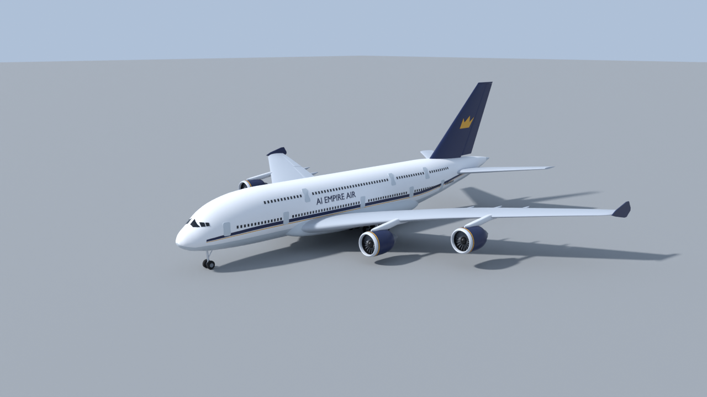

# Skyliner380 – generic double-deck four-engine airliner for "AI Empire"

A game-ready, low-poly-but-smooth model of a **full-length double-deck, four-engine wide-body airliner**
with the proportions of the Airbus A380-800. In game it is only ever called **Skyliner380**; it carries
no real brand names, logos or liveries. The livery is the fictional **"AI EMPIRE AIR"**: white fuselage,
navy/gold cheatline, light-grey belly, navy fin with a gold crown emblem, navy nacelles.



## Files

| File | What it is |
|---|---|
| `model.py` | Full reproducible Blender (bpy 5.0.1) script: builds, checks, exports, renders, re-imports the FBX and writes the manifest. |
| `Skyliner380.fbx` | **Main deliverable for Roblox.** 65 separate mesh objects, 1 Blender unit = 1 stud, face-corner vertex colours (sRGB), one named material per object. |
| `Skyliner380.obj` + `Skyliner380.mtl` | Fallback. Same 65 objects and materials, but **no vertex colours**, so each object gets only its base colour. |
| `manifest.json` | Every object: triangle count, pivot (studs and metres), hinge axis, rotation limits, `moves_with`, CanCollide flag, fallback colour. Also the scale, axes, export settings and verification results. |
| `renders/` | `front.png`, `side.png`, `top.png` (square, so the full span fits), `three_quarter.png`, `rear_three_quarter.png`, close-ups `closeup_cockpit.png`, `closeup_engine.png`, `closeup_gear.png` (Cycles CPU, 32 samples, denoised). |
| `_research/` | Downloaded source material (Airbus AC document text, traced 3-view masks, Roblox docs pages as Markdown). |
| `_scratch/` | Working files: `compare.py` (silhouette check against the Airbus 3-view), `debug_views.py`, `build_log.txt`. These are not deliverables. |

Rebuild everything (about 1 s to build and export, plus about 5–10 min of Cycles renders on 4 CPU cores):

```bash
python3 model.py                 # bpy as a Python module
python3 model.py --no-render     # skip the Cycles renders
python3 model.py --no-verify     # skip the FBX re-import check
```

## Real-world reference dimensions (A380-800) and how the model matches

Primary source: **Airbus, "A380 Aircraft Characteristics – Airport and Maintenance Planning" (AC), Rev. Nov 01/12**,
section 2-2-0 "General Aircraft Dimensions" and 7-2-0 "Landing Gear Footprint".
The PDF used is the copy hosted by SKYbrary: <https://skybrary.aero/sites/default/files/bookshelf/2375.pdf>.
Current Airbus editions are linked from <https://aircraft.airbus.com/en/customer-care/fleet-wide-care/airport-operations-and-aircraft-characteristics/aircraft-characteristics>
(the direct Airbus PDF was blocked by a bot wall from this sandbox, so the SKYbrary copy was used).
Wing area and sweep come from Wikipedia "Airbus A380", specifications table: <https://en.wikipedia.org/wiki/Airbus_A380>
(that table cites the Airbus AC document).

| Quantity | Published | Model | Source |
|---|---|---|---|
| Overall length | 72.72 m (AC figure: 72.73 m) | **72.72 m** | Wikipedia spec table; AC 2-2-0 |
| Wingspan | 79.75 m | **79.75 m** (to the outside of the wing-tip fences) | AC 2-2-0 |
| Height (tail tip) | 24.09 m | **24.09 m** | Wikipedia spec table / AC 2-2-0 |
| Fuselage max width | 7.14 m | 7.14 m | AC 2-2-0 |
| Fuselage max height | 8.41 m | 8.41 m | AC 2-2-0 |
| Horizontal tail span | 30.37 m | 30.30 m | AC 2-2-0 |
| Nose gear station (from nose) | 4.97 m | 4.97 m | AC 2-2-0 |
| Wing gear / body gear station | 33.58 m / 36.85 m | 33.58 m / 36.85 m (bogie centres) | AC 2-2-0 |
| Wing gear track / body gear track | 12.46 m / 5.26 m | 12.456 m / 5.264 m | AC 2-2-0, 7-2-0 |
| Bogie axle spacing | 1.70 m | 1.70 m | AC 7-2-0 |
| Engine centrelines from aircraft centreline | 14.8 m (29.6 m apart) / 25.7 m (51.4 m apart) | 14.80 m / 25.70 m | AC 2-2-0 front view |
| Wing area | 845 m² (reference area) | ≈ 868 m² (gross planform traced to the centreline; not the same definition as the Airbus reference area) | Wikipedia |
| Wing sweep | 33.5° (quarter chord) | 33.2° outer panel, 34.8° inner panel (quarter chord) | Wikipedia |
| Main tyres / nose tyres | 1.40 m × 0.53 m / 1.27 m × 0.455 m | as published | AC 7-2-0 |
| Landing gear | 22 wheels: nose 2, two 4-wheel wing gears, two 6-wheel body gears | 22 wheels, same arrangement | AC 7-2-0 |

The fuselage, wing, tail and nacelle outlines were **traced from the Airbus 3-view** (AC 2-2-0 at 21.2 px/m) and then
compared with it automatically (`_scratch/compare.py`). Silhouette overlap (intersection over union) between the
model and the drawing: side 0.9252, top 0.9486, front 0.879. The front view scores lowest because the drawing's
flap-track fairings and nacelle outlines are a little deeper than the model's.

## Roblox scale, limits and import rules (official docs)

| Rule | Value | Source |
|---|---|---|
| Length unit | **1 stud = 28 cm** → 1 m = 3.5714 studs | <https://create.roblox.com/docs/physics/units> |
| Triangle budget | "Individual meshes can not exceed **20,000 triangles**." | <https://create.roblox.com/docs/art/modeling/specifications> |
| Geometry | watertight, no exposed holes or backfaces; quads where possible; meshes must have volume (no zero thickness) | same page |
| Blender FBX export | Path Mode = Copy + Embed Textures; **Apply Scalings = "FBX Unit Scale"**; Add Leaf Bones off; Bake Animation off | <https://create.roblox.com/docs/art/modeling/export-requirements> |
| Axes (Blender → Studio) | Forward = **Z Forward**, Up = **Y Up**; FBX Unit Scale keeps the scale the same in Studio | <https://create.roblox.com/docs/art/blender> (section "Adjust scale (FBX)" and export steps) |
| Importer | File → Import; .fbx/.gltf support multiple mesh objects, hierarchies and **vertex colours**; Scale Unit defaults to **Studs**; "Set Pivot to Scene Origin" on by default; "Use Imported Pivot" on by default; "Anchored" off by default; "Merge Meshes" off by default; "Ignore Vertex Colors" off by default | <https://create.roblox.com/docs/studio/importer> |
| Vertex colours | multiplied by the MeshPart's `Color`/`BrickColor` (default Medium Stone Grey 163,162,165), so set `Color` to **255,255,255** to see them exactly | Roblox staff post "Vertex Colored Meshes using Blender and Studio" (2 Jul 2024): <https://devforum.roblox.com/t/vertex-colored-meshes-using-blender-and-studio/3050119> |

**Scale used:** geometry is authored in metres and multiplied by **K = 1/0.28 = 3.5714** before export, so
**1 Blender unit = 1 stud** and the raw vertex numbers in the FBX are studs. Import with *Scale Unit = Studs*
and the aircraft arrives at **259.7 × 284.8 × 86.0 studs** (length × span × height).
If your game uses a different stud scale, scale the whole Model afterwards with `Model:ScaleTo(factor)`, so that every
pivot scales with it.

## Coordinate system, origin and pivots

* **Roblox model space (as imported):** X = right (starboard), Y = up, **−Z = forward (nose)**, which matches Roblox's
  `CFrame.LookVector` convention. In Blender the nose points to −Y, X = port (left), Z = up.
* **Model origin** = on the ground (tyre contact, Y = 0), on the centreline, 35.50 m (126.79 studs) aft of the nose,
  which is the centroid of the 20 main-gear wheels. With "Set Pivot to Scene Origin" this becomes the Model pivot,
  so `model:PivotTo(CFrame.new(x, groundY, z))` parks the aircraft on the ground.
* **Every object's origin is at its real hinge or axis.** Rotation and scale are applied (identity), so every MeshPart
  is axis-aligned with the Model. With "Use Imported Pivot" the origin becomes the MeshPart's pivot (`part:GetPivot()`).
  Note that `part.Position` is the bounding-box centre, not the hinge.

| Object(s) | Pivot | Hinge axis (manifest `hinge_axis_roblox`) | Limits (deg) |
|---|---|---|---|
| Aileron_L/R, Flap_L/R_Inner/Outer, Elevator_L/R | middle of the swept hinge line (`hinge_line_studs_roblox` gives both ends) | along the hinge line; +angle = trailing edge **down** | aileron −25…+20, flaps 0…35, elevator −30…+20 |
| Rudder | middle of the fin hinge line | along the hinge line; +angle = trailing edge to starboard | −30…+30 |
| Fan_1..4 | engine axis at the fan plane | engine axis (+Z, aft); continuous spin | – |
| NoseGear | strut trunnion | lateral; +95° = retracted forward | 0…95 |
| MainGear_WL/WR (wing gears) | strut trunnion under the wing | longitudinal; +90° = retracted inboard | 0…90 |
| MainGear_BL/BR (body gears) | strut trunnion in the belly | lateral; +90° = retracted aft | 0…90 |
| *_Wheels* | axle centre | lateral (wheel spin) | – (move with their leg, see `moves_with`) |
| Door_M1L…Door_U3R | forward door edge, just outside the skin | about vertical, swinging outward | 0…100 |
| Static parts (Fuselage, Wing_*, Fence_*, HStab_*, VStab, Engine_*, windows, titles, logo) | Fuselage = model origin; others at a sensible root point | – | – |

Engines are numbered from left to right as seen from the cockpit (1 = left outboard, 4 = right outboard).
`Engine_n` is the nacelle + core + pylon; `Fan_n` is the spinner + 20 fan blades, which spin.

## Objects and triangle counts

All 65 objects are closed, manifold meshes (0 non-manifold edges). Every object has a positive signed volume, so its
normals point outward. Smooth shading uses angle-based sharp edges of 30–50° depending on the part.
The largest single mesh is `Fuselage` with **8,444** triangles, well under the 20,000 limit. Total: **39,586 triangles**
(target was 60k or fewer for an A380-class airliner).

| Object | Role | Triangles | Material | Moves | CanCollide | Pivot (studs, X right / Y up / Z aft) |
|---|---|---:|---|---|---|---|
| `Fuselage` | fuselage (incl. belly fairing) | 8,444 | MAT_Fuselage | – | **yes** | (0.00, 0.00, 0.00) |
| `WindowStrip_Main_L` | main-deck window row | 900 | MAT_WindowGlass | – | no | (-12.75, 22.07, -8.66) |
| `WindowStrip_Main_R` | main-deck window row | 900 | MAT_WindowGlass | – | no | (12.75, 22.07, -8.66) |
| `WindowStrip_Upper_L` | upper-deck window row | 744 | MAT_WindowGlass | – | no | (-10.88, 31.96, -3.57) |
| `WindowStrip_Upper_R` | upper-deck window row | 744 | MAT_WindowGlass | – | no | (10.88, 31.96, -3.57) |
| `WindowStrip_Cockpit` | cockpit windscreen panes | 256 | MAT_WindowGlass | – | no | (0.00, 25.71, -116.07) |
| `Door_M1L` | passenger door M1L (main deck) | 128 | MAT_Door | yes | no | (-10.34, 21.85, -106.15) |
| `Door_M1R` | passenger door M1R (main deck) | 128 | MAT_Door | yes | no | (10.34, 21.85, -106.15) |
| `Door_M2L` | passenger door M2L (main deck) | 128 | MAT_Door | yes | no | (-12.90, 21.83, -69.77) |
| `Door_M2R` | passenger door M2R (main deck) | 128 | MAT_Door | yes | no | (12.90, 21.83, -69.77) |
| `Door_M3L` | passenger door M3L (main deck) | 128 | MAT_Door | yes | no | (-12.90, 21.83, -11.98) |
| `Door_M3R` | passenger door M3R (main deck) | 128 | MAT_Door | yes | no | (12.90, 21.83, -11.98) |
| `Door_M4L` | passenger door M4L (main deck) | 128 | MAT_Door | yes | no | (-12.90, 21.83, 31.09) |
| `Door_M4R` | passenger door M4R (main deck) | 128 | MAT_Door | yes | no | (12.90, 21.83, 31.09) |
| `Door_M5L` | passenger door M5L (main deck) | 128 | MAT_Door | yes | no | (-11.87, 21.80, 62.86) |
| `Door_M5R` | passenger door M5R (main deck) | 128 | MAT_Door | yes | no | (11.87, 21.80, 62.86) |
| `Door_U1L` | passenger door U1L (upper deck) | 128 | MAT_Door | yes | no | (-11.17, 31.73, -53.91) |
| `Door_U1R` | passenger door U1R (upper deck) | 128 | MAT_Door | yes | no | (11.17, 31.73, -53.91) |
| `Door_U2L` | passenger door U2L (upper deck) | 128 | MAT_Door | yes | no | (-11.17, 31.73, 15.23) |
| `Door_U2R` | passenger door U2R (upper deck) | 128 | MAT_Door | yes | no | (11.17, 31.73, 15.23) |
| `Door_U3L` | passenger door U3L (upper deck) | 128 | MAT_Door | yes | no | (-11.29, 31.73, 46.98) |
| `Door_U3R` | passenger door U3R (upper deck) | 128 | MAT_Door | yes | no | (11.29, 31.73, 46.98) |
| `Wing_L` | wing (incl. flap-track fairings) | 2,134 | MAT_Wing | – | no | (-14.29, 13.54, -57.01) |
| `Fence_L` | wing-tip fence | 32 | MAT_Fence | – | no | (-142.14, 27.50, 40.96) |
| `Flap_L_Inner` | flap | 176 | MAT_ControlSurface | yes | no | (-31.43, 16.77, -5.17) |
| `Flap_L_Outer` | flap | 236 | MAT_ControlSurface | yes | no | (-72.14, 22.32, 14.90) |
| `Aileron_L` | aileron | 206 | MAT_ControlSurface | yes | no | (-116.79, 26.24, 39.06) |
| `HStab_L` | horizontal stabiliser | 502 | MAT_HStab | – | no | (0.00, 26.61, 77.54) |
| `Elevator_L` | elevator | 236 | MAT_ControlSurface | yes | no | (-28.75, 29.14, 116.11) |
| `Wing_R` | wing (incl. flap-track fairings) | 2,134 | MAT_Wing | – | no | (14.29, 13.54, -57.01) |
| `Fence_R` | wing-tip fence | 32 | MAT_Fence | – | no | (142.14, 27.50, 40.96) |
| `Flap_R_Inner` | flap | 176 | MAT_ControlSurface | yes | no | (31.43, 16.77, -5.17) |
| `Flap_R_Outer` | flap | 236 | MAT_ControlSurface | yes | no | (72.14, 22.32, 14.90) |
| `Aileron_R` | aileron | 206 | MAT_ControlSurface | yes | no | (116.79, 26.24, 39.06) |
| `HStab_R` | horizontal stabiliser | 502 | MAT_HStab | – | no | (0.00, 26.61, 77.54) |
| `Elevator_R` | elevator | 236 | MAT_ControlSurface | yes | no | (28.75, 29.14, 116.11) |
| `VStab` | vertical stabiliser (fin) | 502 | MAT_Tail | – | no | (0.00, 38.57, 65.86) |
| `Rudder` | rudder | 236 | MAT_Tail | yes | no | (0.00, 60.71, 110.71) |
| `TailLogo` | fictional AI Empire crown emblem (both sides of fin) | 48 | MAT_Logo | – | no | (0.00, 58.93, 101.68) |
| `Titles_L` | "AI EMPIRE AIR" titles (fictional) | 596 | MAT_Titles | – | no | (-12.35, 27.48, -30.94) |
| `Titles_R` | "AI EMPIRE AIR" titles (fictional) | 596 | MAT_Titles | – | no | (12.35, 27.48, -30.94) |
| `Engine_1` | engine nacelle + core + pylon | 1,724 | MAT_Engine | – | no | (-91.79, 15.18, -16.46) |
| `Fan_1` | fan + spinner (spins) | 640 | MAT_Fan | yes | no | (-91.79, 15.18, -16.46) |
| `Engine_2` | engine nacelle + core + pylon | 1,724 | MAT_Engine | – | no | (-52.86, 11.00, -44.00) |
| `Fan_2` | fan + spinner (spins) | 640 | MAT_Fan | yes | no | (-52.86, 11.00, -44.00) |
| `Engine_3` | engine nacelle + core + pylon | 1,724 | MAT_Engine | – | no | (52.86, 11.00, -44.00) |
| `Fan_3` | fan + spinner (spins) | 640 | MAT_Fan | yes | no | (52.86, 11.00, -44.00) |
| `Engine_4` | engine nacelle + core + pylon | 1,724 | MAT_Engine | – | no | (91.79, 15.18, -16.46) |
| `Fan_4` | fan + spinner (spins) | 640 | MAT_Fan | yes | no | (91.79, 15.18, -16.46) |
| `NoseGear` | landing-gear leg (retracts forward) | 160 | MAT_GearStrut | yes | no | (0.00, 10.18, -109.82) |
| `NoseGear_Wheels` | wheel pair on axle 1 of NoseGear (spins; moves with the leg) | 512 | MAT_Tyre | yes | no | (0.00, 2.27, -109.04) |
| `MainGear_WL` | landing-gear leg (retracts inboard) | 288 | MAT_GearStrut | yes | no | (-22.24, 13.75, -9.82) |
| `MainGear_WL_Wheels1` | wheel pair on axle 1 of MainGear_WL (spins; moves with the leg) | 512 | MAT_Tyre | yes | no | (-22.24, 2.50, -9.89) |
| `MainGear_WL_Wheels2` | wheel pair on axle 2 of MainGear_WL (spins; moves with the leg) | 512 | MAT_Tyre | yes | no | (-22.24, 2.50, -3.82) |
| `MainGear_BL` | landing-gear leg (retracts aft into the belly) | 352 | MAT_GearStrut | yes | no | (-9.40, 13.93, 3.75) |
| `MainGear_BL_Wheels1` | wheel pair on axle 1 of MainGear_BL (spins; moves with the leg) | 512 | MAT_Tyre | yes | no | (-9.40, 2.50, -1.25) |
| `MainGear_BL_Wheels2` | wheel pair on axle 2 of MainGear_BL (spins; moves with the leg) | 512 | MAT_Tyre | yes | no | (-9.40, 2.50, 4.82) |
| `MainGear_BL_Wheels3` | wheel pair on axle 3 of MainGear_BL (spins; moves with the leg) | 512 | MAT_Tyre | yes | no | (-9.40, 2.50, 10.89) |
| `MainGear_WR` | landing-gear leg (retracts inboard) | 288 | MAT_GearStrut | yes | no | (22.24, 13.75, -9.82) |
| `MainGear_WR_Wheels1` | wheel pair on axle 1 of MainGear_WR (spins; moves with the leg) | 512 | MAT_Tyre | yes | no | (22.24, 2.50, -9.89) |
| `MainGear_WR_Wheels2` | wheel pair on axle 2 of MainGear_WR (spins; moves with the leg) | 512 | MAT_Tyre | yes | no | (22.24, 2.50, -3.82) |
| `MainGear_BR` | landing-gear leg (retracts aft into the belly) | 352 | MAT_GearStrut | yes | no | (9.40, 13.93, 3.75) |
| `MainGear_BR_Wheels1` | wheel pair on axle 1 of MainGear_BR (spins; moves with the leg) | 512 | MAT_Tyre | yes | no | (9.40, 2.50, -1.25) |
| `MainGear_BR_Wheels2` | wheel pair on axle 2 of MainGear_BR (spins; moves with the leg) | 512 | MAT_Tyre | yes | no | (9.40, 2.50, 4.82) |
| `MainGear_BR_Wheels3` | wheel pair on axle 3 of MainGear_BR (spins; moves with the leg) | 512 | MAT_Tyre | yes | no | (9.40, 2.50, 10.89) |
| **Total** | 65 objects | **39,586** | | | | |

Materials (one per object, named): `MAT_Fuselage`, `MAT_WindowGlass`, `MAT_Door`, `MAT_Wing`, `MAT_ControlSurface`,
`MAT_HStab`, `MAT_Tail`, `MAT_Fence`, `MAT_Logo`, `MAT_Titles`, `MAT_Engine`, `MAT_Fan`, `MAT_GearStrut`, `MAT_Tyre`.
The livery detail (cheatline, belly, nacelle lip and stripe, tyre and hub, and so on) is in **face-corner vertex colours**,
so no textures are needed. Palette (sRGB): white #F4F5F8, belly #C7CFD6, navy #0F1F4A, gold #DEA32E, wing #B8BFC9.

## Export settings used (`model.py → export_all()`)

FBX (`bpy.ops.export_scene.fbx`): `apply_scale_options='FBX_SCALE_UNITS'` (= "FBX Unit Scale"), `global_scale=1.0`,
`apply_unit_scale=True`, `axis_forward='Z'`, `axis_up='Y'`, `bake_space_transform=True`, `object_types={'MESH'}`,
`use_mesh_modifiers=True`, `mesh_smooth_type='FACE'`, `use_triangles=True`, `colors_type='SRGB'`, `add_leaf_bones=False`,
`bake_anim=False`, `path_mode='COPY'`, `embed_textures=True`. Scene units: metric, unit scale 1.0, so 1 BU = 1 stud.

OBJ (`bpy.ops.wm.obj_export`): `forward_axis='Z'`, `up_axis='Y'`, `global_scale=1.0`, triangulated, normals and UVs, materials, no vertex colours. Afterwards the `Kd` lines of the `.mtl` are rewritten with the sRGB palette values (Blender writes linear values, which made the navy look black).

## Verification (run automatically by `model.py`, results in `manifest.json → verification`)

* **FBX re-import into Blender** (`import_scene.fbx`, forward Z / up Y): 65 mesh objects, bounding box **284.82 × 259.73 × 86.04 studs** (span × length × height) = 79.75 × 72.724 × 24.091 m. Reference: 79.75 × 72.72 × 24.09 m.
* **Raw FBX parse** (the numbers Roblox reads, Scale Unit = Studs): vertex extent [284.822, 86.036, 259.734] in FBX axes (X span, Y height, Z length), min [-142.411, 0.0, -126.786], max [142.411, 86.036, 132.948], so the nose is at −Z. GlobalSettings: UpAxis=1 (Y), FrontAxis=2, UnitScaleFactor=100.0. Models with non-zero rotation: none; with non-unit scale: none (transforms applied).
* **Pivots survive the round trip:** largest pivot deviation after re-import is 0.0 studs; missing objects: none.
* **Triangle limit:** 39,586 triangles after re-import (same as built: 39,586); objects over 20,000: none; largest mesh 8,444.
* **Vertex colours survive the FBX round trip:** objects without colours: none; palette colours found: belly, core, dark, door, fan, glass, gold, lip, metal, navy, pylon, strut, tyre, white, wing; off-palette values: none.
* **Mesh hygiene (before export):** 0 non-manifold edges on all 65 objects, every signed volume > 0 (outward normals), no unapplied transforms, problems list: empty.
* **Silhouette against the Airbus 3-view:** IoU side 0.9252, top 0.9486, front 0.879 (`_scratch/compare.py`, overlays `_scratch/proportion_check_*.png`).
* **Renders inspected** (all views plus close-ups and extra debug views of the wing root, belly, pylons, tail and gear) for silhouette, proportions, smoothness and gaps.

What has **not** been verified: the import itself in Roblox Studio (Studio is not available in this sandbox), so the
Luau snippet below has not been run either. The settings follow the official docs cited above.

## Import into Roblox Studio – step by step

1. **File → Import** (the Importer; on older Studio builds it is *File → Import 3D*, or the Asset Manager's *Import* button) and pick `Skyliner380.fbx`.
2. In the import preview, keep or set:
   * **File Geometry → Scale Unit: Studs** (the default). The imported Model should measure about 259.7 (length) × 284.8 (span) × 86.0 (height) studs.
   * **File Transform → World Forward: Front, World Up: Top** (defaults).
   * **Set Pivot to Scene Origin: on** (default): the Model pivot becomes the ground point under the main gear.
   * **Use Imported Pivot: on** for every object (default), so the hinges are kept.
   * **Merge Meshes: off** (default). We need 65 separate MeshParts.
   * **Anchored: off** (default). This is a vehicle.
   * **Ignore Vertex Colors: off** (default). The livery is in the vertex colours.
   * *Upload to Roblox* as you prefer; *Add to Workspace: on* also grants the place permission to use the meshes.
3. Click **Import**. You get a `Model` called `Skyliner380` with 65 `MeshPart` children named exactly like the table above.
   If the nose points to +Z instead of −Z, rotate the Model 180° about Y; the hinge data is unaffected because it is relative to the Model.
4. **Colours:** select all MeshParts and set `Color` = **255, 255, 255** (white). Vertex colours are multiplied by `Color`,
   and the default grey would darken the livery. Optionally set `Material` = SmoothPlastic and leave `TextureID` empty.
   If vertex colours were ignored for some reason, use each object's `studio_fallback_color_rgb` from `manifest.json` instead.
5. **Physics properties:**
   * `Anchored = false` on all parts (the game code anchors or welds as it needs).
   * `CanCollide = true` **only on `Fuselage`** (CollisionFidelity = Hull or Default). All other parts: `CanCollide = false`,
     `CanTouch = false`, `CanQuery = false`, CollisionFidelity = Box (cheapest), and optionally `Massless = true`.
   * `Model.PrimaryPart = Fuselage`.
6. Weld or motor everything to `Fuselage` (see the snippet), otherwise unanchored parts fall apart.
7. Move the Model to **`ReplicatedStorage › VehicleAssets › Skyliner380`**. Create the `VehicleAssets` Folder if it does not exist.
   The game code clones it from there. The Model's direct children must be the MeshParts with the exact names above;
   joints can live inside the parts.

### Optional setup snippet (Luau, run once in the Studio command bar; **untested**)

```lua
-- Run once in the Studio command bar after importing. Not executed in Studio by the author: check the result.
local model = workspace:FindFirstChild("Skyliner380")
local fus = model:FindFirstChild("Fuselage")
model.PrimaryPart = fus
local MOVING = { Fan_ = true, Aileron_ = true, Flap_ = true, Elevator_ = true, Rudder = true,
                 Door_ = true, NoseGear = true, MainGear_ = true }
local function isMoving(name)
    for prefix in pairs(MOVING) do
        if string.sub(name, 1, #prefix) == prefix then return true end
    end
    return false
end
for _, p in ipairs(model:GetChildren()) do
    if p:IsA("MeshPart") then
        p.Color = Color3.new(1, 1, 1)          -- vertex colours are multiplied by Color
        p.Anchored = false
        local isBody = (p == fus)
        p.CanCollide = isBody
        p.CanTouch = isBody
        p.CanQuery = isBody
        if not isBody then
            p.Massless = true
            -- hinge frame: at the imported pivot, axes aligned with the Model
            local hinge = CFrame.new(p:GetPivot().Position) * fus.CFrame.Rotation
            if isMoving(p.Name) then
                local m = Instance.new("Motor6D")
                m.Name = p.Name .. "_Joint"
                -- wheels should hang on their gear leg (manifest "moves_with"); here everything hangs on Fuselage
                m.Part0 = fus
                m.Part1 = p
                m.C0 = fus.CFrame:Inverse() * hinge
                m.C1 = p.CFrame:Inverse() * hinge
                m.Parent = p
            else
                local w = Instance.new("WeldConstraint")
                w.Part0 = fus
                w.Part1 = p
                w.Parent = p
            end
        end
    end
end
```

To animate a control surface with this setup, set `joint.Transform = CFrame.fromAxisAngle(axis, math.rad(deg))`, where
`axis` is `Vector3.new(table.unpack(hinge_axis_roblox))` from the manifest (Model space, positive = right-hand rule).
Clamp `deg` to `rotation_limits_deg`. For gear retraction, Part0 of each `*_Wheels*` joint should be its gear leg
(`moves_with`), so the wheels follow the leg.

## What is simplified (honest list)

* **Stylised, not photoreal:** no panel lines, no textures, flat vertex-colour livery. Doors and windows are thin raised
  slabs on the skin (separate meshes), not cut-outs, and there is no cabin interior.
* **Control surfaces:** one aileron per side (the real aircraft has three), two flap segments per side (the real one has
  three plus droop-nose leading-edge devices), one elevator per side (real: two), single rudder (real: split upper/lower).
  No spoilers or slats. Flaps are a pure rotation about the hinge line; real Fowler flaps also move aft.
* **Doors** swing about their forward edge. Real doors of this type first move outward, then swing forward parallel to the skin.
* **Landing gear:** legs are simple cylinders with one brace each; bogies are a beam with axles. There are no gear doors
  or gear bays: a retracted gear simply goes inside the belly or wing.
* **Wing:** a smooth lofted airfoil with dihedral, washout and a slight camber. The wing-tip fence is a simple swept plate.
  Gross planform area ≈ 868 m² against the 845 m² reference area (different definitions, see above).
* **Engines:** nacelle + core + pylon + fan disc with 20 blades. The fan blades are thin solid slabs.
* The OBJ fallback has no vertex colours, so it is one colour per object.

## Open issues / to check in Studio

* The Studio import has not been tested here (no Studio in the sandbox). Check the size against the expected
  259.7 × 284.8 × 86.0 studs, the orientation (nose toward −Z) and that the vertex colours show up.
* Roblox recalculates MeshPart collision and render LOD itself. For a 285-stud-wide aircraft, use RenderFidelity = Automatic
  and keep CollisionFidelity = Box on all non-fuselage parts.
